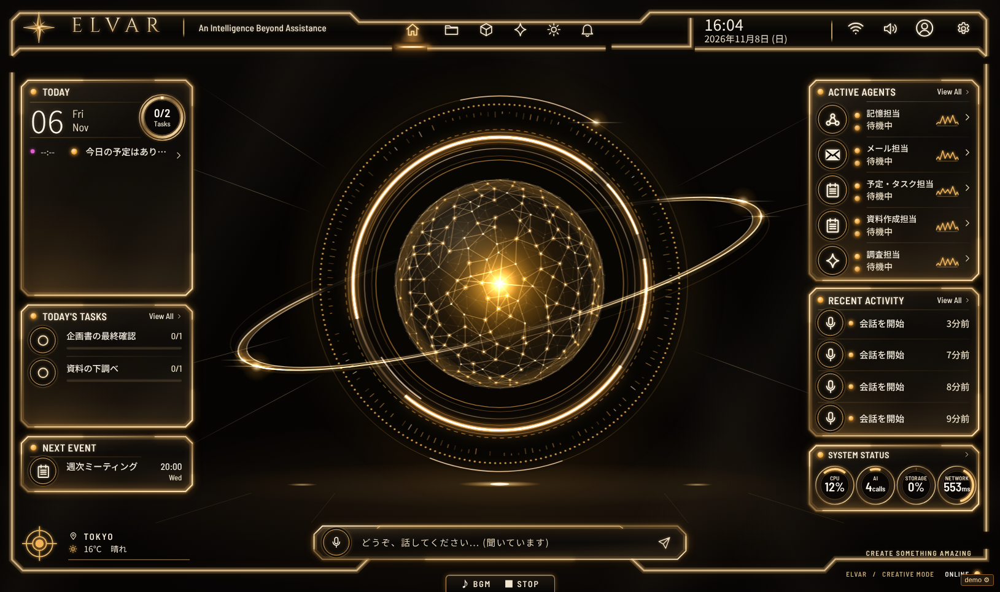

# E.L.V.A.R.

**E**volving **L**earning **V**irtual **A**daptive **R**easoning（読み方: 「エルヴァー」）

E.L.V.A.R. は、1つの共通プラットフォームを、たくさんの人が使うAIアシスタントです。
声で話せる金色のHUD（画面）があり、人ごとに別のAI人格、記憶、ファイル保管庫、Google連携を持ちます。
オープンソース（MIT）です。自分で動かして、仲間に使ってもらうこともできます。



> English summary is at the bottom of this page.

## 状態

開発中です。バージョンは 0.0.1 です。
自動テストは通りますが、本物の Supabase と Vercel を使った通しの確認が、まだ終わっていない部分があります。
どこが未確認かは、`docs/ELVAR_MULTIUSER.md` の §12〜§18 にある「未着手・要確認」に書いてあります。
公開サービスとして始める前に、必ず `docs/SETUP.md` の「無料プランについて」を読んでください。

## できること

**話す**
- 声での会話（Gemini Live）。ブラウザから Google に直接つなぎます。
- 拍手2回で起こす「拍手ウェイク」。デスクトップアプリ（Electron）とChrome拡張で、隠れた窓を前面に出せます。
- ヒューマンプロトコル。「ヒューマンプロトコル」と言うと、HUDが粒子の人型に変わります。
- 通常の文字・音声モード（Live の上限に達したときの控え）。

**あなた専用にする**
- AIの名前、呼び方、口調、あいさつ、声を、自分で決めます。
- 初回のウィザードで、Gemini のAPIキーと人格を設定します。

**覚える**
- 第二の脳。Markdownのノートです。閲覧、編集、以前の版、ゴミ箱、検索、リンクの図があります。
- 会話の記録（短期記憶）。残す期間を自分で決められます。1件ずつ消せます。
- 家計、シフト、履修、プロジェクトは、第二の脳のノートとして入ります。
- 学習した好みは、プロフィールのノートに入ります。見て、直して、消せます。

**ファイル**
- ファイル保管庫（既定 500MB、1ファイル 60MB まで）。
- 中身の読み取り、種類の推測、キーワード、検索、同じファイルの見分け。
- 「〇〇をプリントして」で印刷。AIに中身を渡すときは、承認カードが出ます。

**つなぐ**
- Google: カレンダー、Gmail、Drive/Docs/Sheets、タスク、連絡先。書き込みは毎回、承認カードで確認します。
- 連携アプリ（コネクタ）: MCPサーバーとHTTPアプリ。道具ごとに承認レベルを決めます。
- サブエージェント（記憶、メール、予定・タスク、資料作成、調査）。
- 製作依頼: 自分のGitHubリポジトリに Issue を作り、Claude Code に作らせます。
- 任意のAI: Groq、Exa（検索）、NewsData（ニュース）、Sarashina。

**自分のデータを守る**
- 利用量と保存容量を、人ごとに数えます。上限を設けられます。
- 「私のデータ」画面で、見る、直す、zipで書き出す、完全に消すことができます。
- 運営者向けの管理画面は、メール・日付・状態・容量・回数しか見せません。

**使える場所**
- ブラウザ（PWA）、Android（WebView のアシスタントアプリ）、デスクトップ（Electron）、Chrome拡張。

## 7つの原則

E.L.V.A.R. は、次の7つを必ず守ります。守れない変更は入れません。

1. **1つの共通プラットフォーム**: コードとサーバーは1つです。ユーザーごとに別のデプロイはしません。
2. **ユーザーごとに独立したAI人格**: 名前、呼び方、口調、あいさつ、声は、人ごとに別です。
3. **ユーザーごとに独立した短期・長期記憶**: 会話の記録、第二の脳、学習した好みは、本人だけのものです。
4. **ユーザーごとに独立したファイル保管庫**: 取り込んだファイルは、本人だけが見られます。
5. **ユーザーごとに独立したGoogle・外部サービス連携**: 鍵とトークンは、本人ごとに分けて暗号化します。
6. **ユーザーごとに保存容量・利用量を管理**: 容量とAPI利用量を本人ごとに数え、上限を設けられます。
7. **データの閲覧・修正・エクスポート・完全削除ができる**: 本人が自分のデータを見て、直して、持ち出して、消せます。

AIの費用は、プラットフォームが持ちません。ユーザーが自分のAPIキー（Gemini は必須）を持ち込みます。
Google連携も、共通のGoogleクライアントはありません。ユーザーが自分のGoogle OAuthクライアントを作って使います。

## しくみ

```
ブラウザ / Android / デスクトップ（同じ Web アプリ）
   │  Authorization: Bearer <Supabase のアクセストークン>
   ▼
Vercel（api/*.js の Functions。新しい入口は api/elvar.js のルーターに足す）
   │  専用ロール elvar_app で接続 → リクエストごとに「そのユーザーとして」SQLを実行（RLS が効く）
   ▼
Supabase
   ├─ Auth      メール＋パスワード、Google サインイン、Turnstile、サインアップ制限の Hook
   ├─ Postgres  テーブルはすべて非公開スキーマ app。全行に user_id。RLS を強制
   └─ Storage   非公開バケット user-files / user-exports（users/<uid>/ の下だけ）

ブラウザ ⇄ Gemini Live は直接つなぎます（音声はサーバーを通りません）。
サーバーが、本人のキーで短命のトークンを発行します。
```

- ユーザーのAPIキーとトークンは、ユーザーごとの鍵で暗号化して保存します。その鍵は、運営者が持つ `ELVAR_KEK` で包みます。
- 全テーブルが、データ台帳（`app.data_registry`）に載ります。台帳を元に、エクスポートと完全削除が動きます。
- どのテーブルが漏れなく載っているかは、テストが確かめます。

くわしくは `docs/ELVAR_MULTIUSER.md` を読んでください。

## ローカルで試す（Supabase なし）

必要なもの: Node.js 22.12 以上。

```bash
npm install
npm run build
ELVAR_DB=memory ELVAR_DEV_AUTH=1 npm run dev:server
```

表示されたアドレス（既定は http://127.0.0.1:8787）を開きます。
偽のログイン、メモリ上のデータ、使い捨ての鍵で動きます。サインアップから HUD まで試せます。

- データは、サーバーを止めると消えます。
- 確認メールは、`http://127.0.0.1:8787/dev-supabase/dev/mailbox` で読めます。
- この方法は、このパソコンだけで使えます。本番（Vercel など）では拒否されます。
- 画面を直しながら試すときは、`npm run build` の代わりに `ELVAR_DB=memory ELVAR_DEV_AUTH=1 npm run dev` を使います。サーバーと Vite を一緒に起動します。
- Windows の PowerShell では、`$env:ELVAR_DB='memory'; $env:ELVAR_DEV_AUTH='1'` を先に実行してください。

声の会話を試すには、ウィザードで本物の Gemini API キーが必要です。

## 自分のプラットフォームを動かす

`docs/SETUP.md` に、Supabase と Vercel を使う手順があります。

## ドキュメント

| 読む人 | ファイル |
|---|---|
| 使う人 | `docs/USER_GUIDE.md` |
| 運営する人 | `docs/SETUP.md` |
| セキュリティ | `docs/SECURITY.md` |
| 開発に加わる人 | `CONTRIBUTING.md` |
| 設計（現行） | `docs/ELVAR_MULTIUSER.md`（§12〜§18 が実装の記録） |
| 決定事項 | `docs/DECISIONS.md` |
| Supabase のDB | `supabase/README.md` |
| Google連携 | `docs/GOOGLE_INTEGRATION.md` |
| 連携アプリ | `docs/CONNECTORS.md` |
| ファイル | `docs/FILES_PRINT.md`, `docs/FILES_MEMORY.md` |
| 音声とHUD | `docs/PHASE1_VOICE_HUD.md`, `docs/HUD_NOTES.md` |
| 製作依頼 | `docs/BUILD_REQUESTS.md` |
| 履修登録サポート | `docs/COURSES.md` |
| Android / デスクトップ / Chrome拡張 | `android/README.md`, `desktop/README.md`, `extension/README.md` |

`docs/ELVAR_ARCHITECTURE.md` は古い計画です。今は `docs/ELVAR_MULTIUSER.md` が正しい文書です。

## ライセンス

MIT です。`LICENSE` を見てください。

---

# English summary

**E.L.V.A.R.** (Evolving Learning Virtual Adaptive Reasoning, pronounced "El-var") is an open-source, multi-user AI assistant platform.
One shared deployment serves many people. Each person signs up and gets:

- their own AI persona (name, tone, greeting, voice),
- their own short-term and long-term memory (conversation log and a Markdown "second brain"),
- their own file vault (500 MB by default, 60 MB per file),
- their own Google connection (using their own Google OAuth client) and app connectors (MCP / HTTP),
- their own usage and storage limits,
- a "My data" screen to view, edit, export (zip) and fully delete everything.

The UI is a gold HUD with voice conversation (Gemini Live), a double-clap wake, and a particle "Human protocol" mode.
The interface and most documents are in Japanese.

**Bring your own keys.** The platform pays for no AI service. Every user adds their own Gemini API key (required) in the setup wizard. Groq, Exa, NewsData and Sarashina keys are optional.

**The 7 principles** (see the Japanese section above and `CLAUDE.md`): one shared platform; independent persona, memory, file vault and external connections per user; per-user storage and usage metering; view / edit / export / full deletion of one's own data. Every table is keyed by `user_id`, and tests check that one user can never reach another user's data.

**Architecture.** Web app + Vercel Functions (`api/*.js`, one router in `api/elvar.js`) + Supabase (Auth, Postgres with row-level security in a private `app` schema, private Storage buckets). User secrets are envelope-encrypted: a per-user key, wrapped by the operator's `ELVAR_KEK`.

**Honest limits.** An operator who holds both the Vercel and the Supabase dashboards can technically read notes and conversations in plaintext. Secrets (API keys, tokens) are encrypted and cannot be read from the database alone. See `docs/SECURITY.md`.

**Status.** Early (0.0.1). The automated tests pass, but some parts have not yet been verified against a real Supabase project; see the "not verified" notes in `docs/ELVAR_MULTIUSER.md` sections 12-18. Use the free plans for testing only and move to paid plans before a public launch (`docs/SETUP.md`).

**Try it locally (no Supabase).** Node.js 22.12 or newer:

```bash
npm install
npm run build
ELVAR_DB=memory ELVAR_DEV_AUTH=1 npm run dev:server
```

Open http://127.0.0.1:8787. This uses a fake login and an in-memory database, and it is refused in production. Confirmation mails appear at `/dev-supabase/dev/mailbox`.

**Run your own platform:** `docs/SETUP.md` (Japanese). **Contribute:** `CONTRIBUTING.md`. **License:** MIT.
