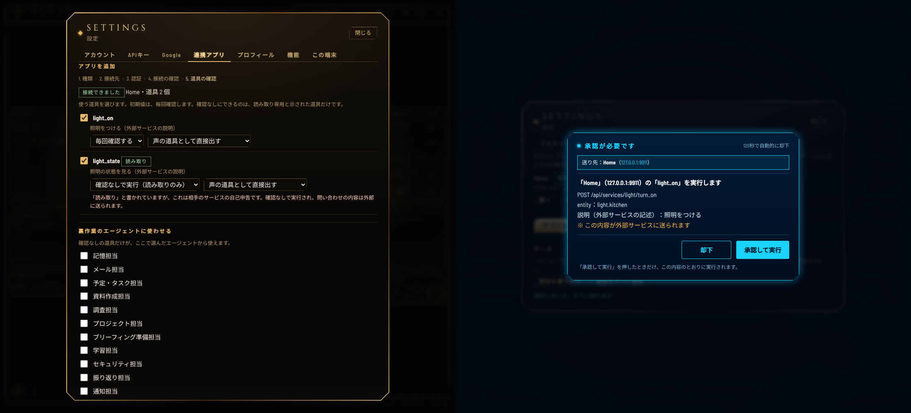

# 連携アプリ（コネクタ）

設定 → 「連携アプリ」から、MCPサーバー（Streamable HTTP。認証なし / トークン / OAuth）と、HTTPアプリ（URL + 道具のJSON + 認証ヘッダー）をつなぎます。
道具は Gemini Live・通常チャット・裏作業のエージェントから、同じ承認の仕組み（`executeTool`）で呼ばれます。



## 承認レベル

| 設定 | 意味 |
|---|---|
| 毎回確認する（既定） | 毎回、承認カード。カードの上に「送り先：アプリ名（ホスト）」が出ます |
| 毎回確認する（強い警告） | 取り消せない可能性のある道具（MCPの `destructiveHint`、HTTPの DELETE）。オレンジ枠 |
| 確認なしで実行 | **読み取り専用と示された道具だけ**、**オーナーが道具ごとに選んだときだけ**。示しは相手の自己申告なので、画面に警告が出ます |
| 使わない | 呼べません |

- 道具の説明・引数・ヒントのどれかが同期で変わると、その道具は**自動で無効**になり、承認も「毎回確認」に戻ります。差分を見て、もう一度有効にするまで使えません。
- 裏作業のエージェントが使えるのは、「確認なしで実行」の道具のうち、オーナーがそのエージェントに許可したものだけです。
- Live に直接出す道具は、全アプリ合計で24個まで。残りは `connector_tools`（一覧）と `connector_call`（実行）から使います。

## ネットワークの制限（`server/net/safe-fetch.js`）

https のみ・ポート 443/8443。解決したアドレスに固定して接続し（DNSリバインディング対策）、社内・ループバック・リンクローカル（クラウドのメタデータ）・CGNAT・予約済みの範囲（IPv6・IPv4射影を含む）は拒否します。リダイレクトは追いません。応答は1MB・15秒まで。

自分のPCで動かしているときだけ、アプリごとに「自宅・社内のネットワークを許可」（`allowPrivate`）を選べます（Vercelでは常に不可）。

## テスト専用の抜け道（本番では有効にできません）

ローカルのモックサーバー（`http://127.0.0.1:…`）につなぐための、テストと動作確認専用のスイッチです。

```bash
ELVAR_UNSAFE_TEST_NETWORK=loopback node server/index.js
```

- 開くのは `127.0.0.0/8` と `::1` だけ（http / 任意のポート）。ほかの範囲は開きません。
- `VERCEL` が設定されているとき、または `NODE_ENV=production` のときは、**値に関係なく無視されます**（呼び出しのたびに判定。`loopbackHatchOn()`）。
- `npm test` は、このスイッチを各テストファイルの中で設定します。本番のデプロイには、この環境変数を設定しないでください。

## データ（書き出し・削除）

- 「設定を書き出す」（`GET /api/elvar/connectors/export`）：アプリの設定・道具の固定ハッシュ・承認の選択。**トークン・シークレット・OAuthトークンは含みません。**
- 「連携をすべて削除」（`POST /api/elvar/connectors/delete-all` `{confirm:"delete"}`）：設定・保存した認証・OAuthトークン・セッション・ロックを消します。
- コネクタのデータのキー名と置き場所は `server/connectors/data.js` だけが知っています（ユーザーごとの名前空間への切り替え口は `currentScope()` の1か所）。
