# 使い方ガイド（利用者向け）

E.L.V.A.R.（エルヴァー）は、あなた専用のAIアシスタントです。
人格、記憶、ファイル、Google連携は、すべてあなただけのものです。ほかの利用者にも、運営者のアプリ内の管理画面にも、中身は見えません。
（運営者について正直なことは、`docs/SECURITY.md` に書いてあります。）

## 1. サインアップ

1. 運営者から教わったアドレスを開きます。
2. 「サインアップ」で、メールアドレスとパスワード（10文字以上）を入れます。Googleアカウントで入ることもできます。
3. 確認メールが届いたら、リンクを開きます。
4. サインインします。

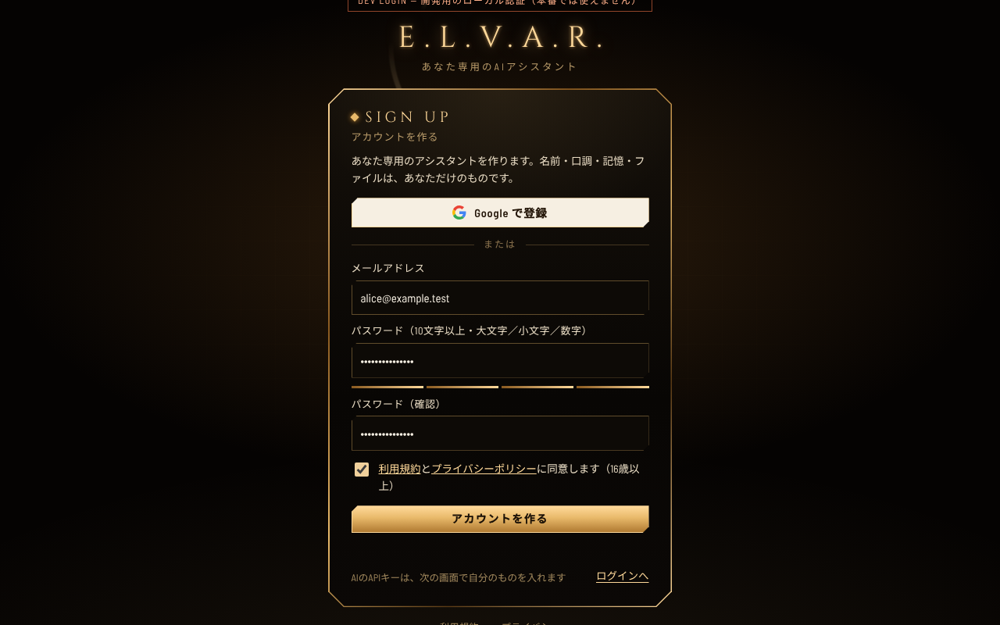

- 確認メールが届かないときは、迷惑メールのフォルダを見てください。
- 運営者が招待制にしているときは、招待されたメールアドレスだけが登録できます。
- 画面に「ロボットでないこと」の確認（Turnstile）が出ることがあります。

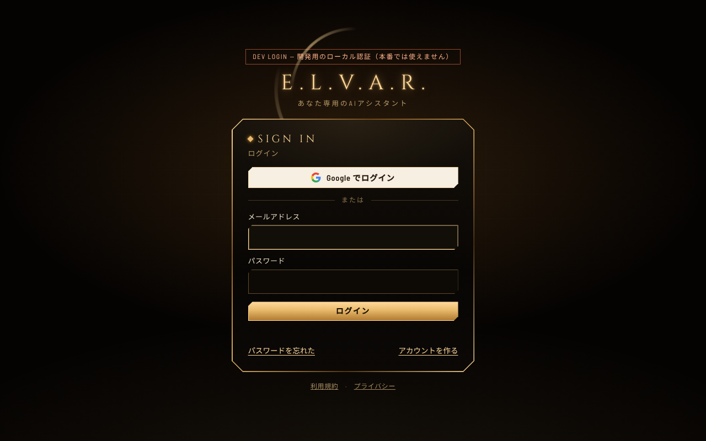

## 2. 最初の設定（ウィザード）

初めてサインインすると、5つの手順が出ます。途中でやめても、次に開いたときに続きから始まります。

### 手順1: Gemini の APIキー（必須）

E.L.V.A.R. は、**あなた自身の Gemini API キー**で動きます。運営者はAIのキーを持っていません。AIの利用は、あなたのキーの枠で数えられます。

キーの作り方:

1. [Google AI Studio](https://aistudio.google.com/apikey) を開き、Googleアカウントでログインします。
2. 「APIキーを作成」を押します。
3. 出てきたキー（`AIza...` で始まる文字列）をコピーします。
4. E.L.V.A.R. のウィザードに貼り付けて、「保存して確認」を押します。

- キーは暗号化して保存されます。保存したあとは、画面に出ません（「設定済み・末尾4桁」だけ）。
- Google側の無料枠や料金は、Googleのページで確かめてください。使いすぎると、料金がかかる場合があります。
- キーを人に見せたり、チャットに貼ったりしないでください。

### 手順2: あなたについて

名前、呼ばれ方、言語、タイムゾーン、住んでいる街を入れます。あとで変えられます。

### 手順3: 話し方と挨拶

AIの人格を決めます。

- 人格のタイプ（または自分で書く「カスタム」）。
- 声。
- あいさつの文と、呼びかけ。
- 「▶ 聞く」で、あいさつを試し聴きできます（試聴は、この端末の読み上げ機能です）。

あなたのAIの名前、口調、あいさつ、声は、あなただけのものです。ほかの人の設定とは別です。

### 手順4: ほかのサービス（任意）

Groq（難しい推論）と Exa（本格的な調べもの）のキーを入れられます。なくても使えます。あとで入れても構いません。

### 手順5: 完了

「HUD を開く」を押します。

## 3. 話しかける

- マイクのボタンを押して話します。
- 拍手を2回すると、待ち受け中のE.L.V.A.R.が起きて、あいさつします（ブラウザでマイクを許可したとき）。
- 文字で打つこともできます（下の入力欄）。
- 「ヒューマンプロトコル」と言うと、粒子の人型になります。「プロトコル解除」か Esc で戻ります。
- 「システムチェック」と言うと、あなたの接続の状態を調べます。

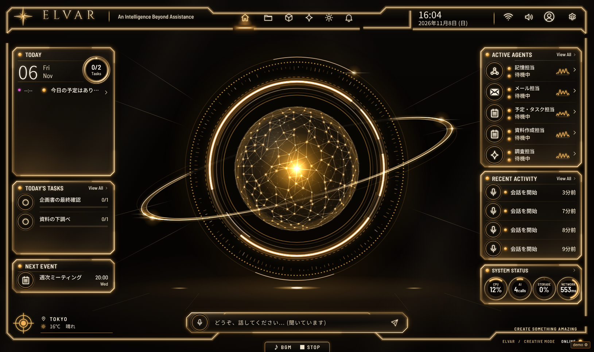

設定は、HUD の右上の歯車（Ctrl+,）から開きます。

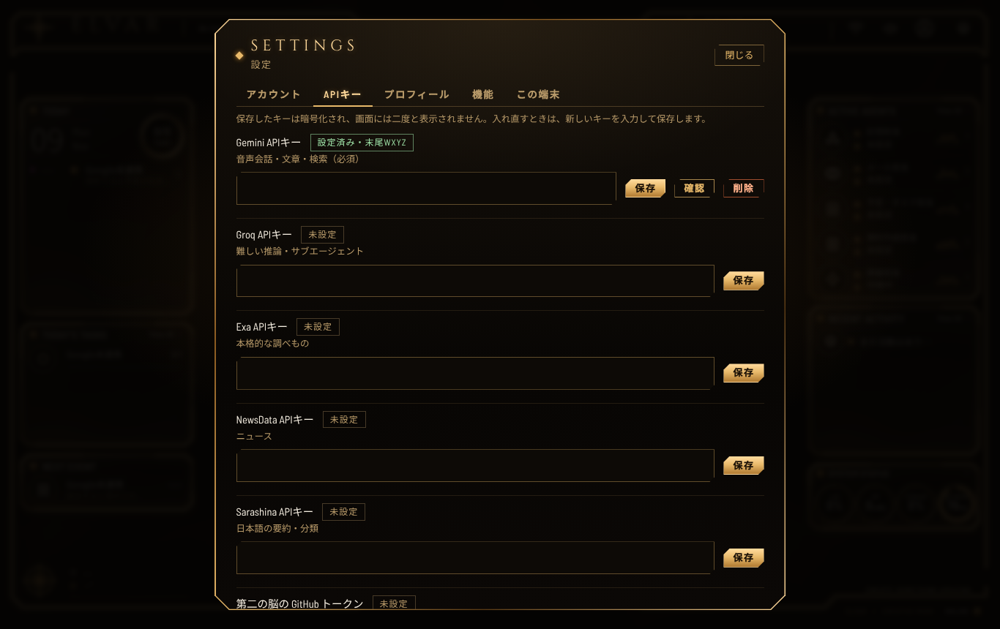

設定には、アカウント、APIキー、Google、連携アプリ、プロフィール、機能、記憶、私のデータ、この端末のタブがあります（管理者には「管理」も出ます）。

## 4. プロフィールと人格を変える

設定 → 「プロフィール」で、名前、呼び方、口調、あいさつ、声をいつでも変えられます。
「私のデータ」→ 「プロフィール・人格・声」→ 「初期の状態に戻す」で、元に戻せます。

## 5. Googleとつなぐ

カレンダー、Gmail、Drive、Docs、Sheets、タスク、連絡先を、E.L.V.A.R.から使えます。

**共通のGoogleクライアントはありません。** あなたが、自分のGoogle Cloudで「OAuthクライアント」を作って、使います。約15分かかります。手順は、アプリの **`/google-setup/`**（日本語の案内ページ）にあります。

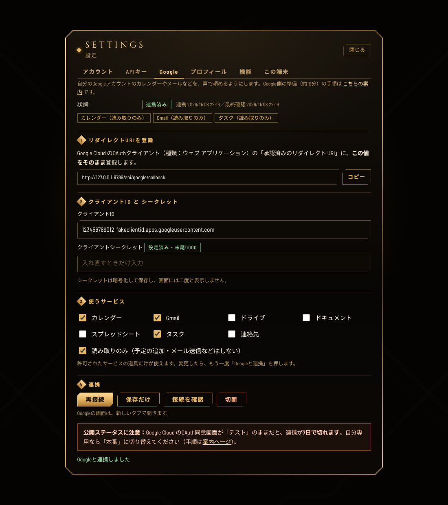

おおまかな流れ:

1. Google Cloud でプロジェクトを作る。
2. 使うAPIを有効にする。
3. OAuthの同意画面を作る。
4. 「ウェブ アプリケーション」のOAuthクライアントを作り、設定 → Google に出るリダイレクトURIを登録する。
5. 設定 → Google に、クライアントIDとシークレットを入れて、使うサービスを選ぶ。
6. 「Googleと連携」を押して、許可する。

安全のしくみ:

- 書き込み（予定の追加、メールの送信、削除など）は、毎回、承認カードで「承認して実行」を押したときだけ動きます。
- 削除は「ゴミ箱に移す」だけです。完全削除はしません。
- 設定 → Google の「切断」で、Google側の許可も取り消せます。

くわしくは `docs/GOOGLE_INTEGRATION.md` にあります。

## 6. 連携アプリ（コネクタ）

設定 → 「連携アプリ」で、MCPサーバーとHTTPアプリをつなぎます。

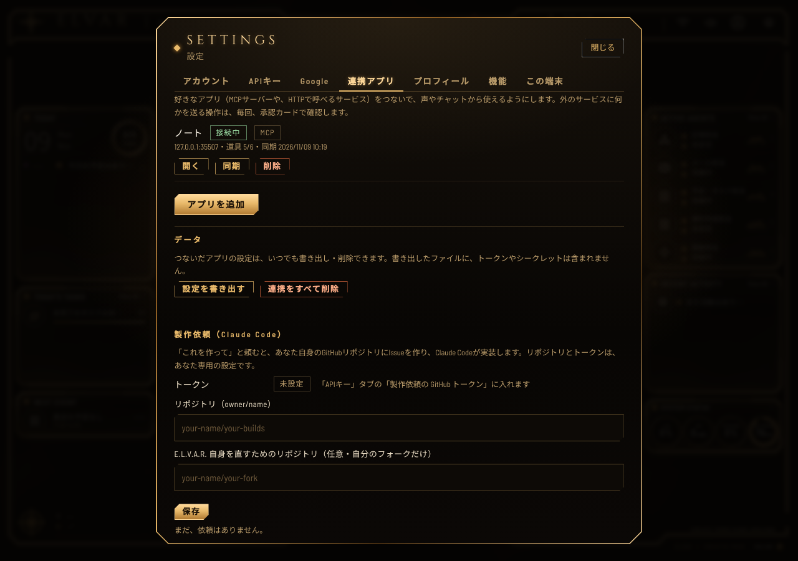

- 道具ごとに、承認のレベルを決めます。既定は「毎回確認する」です。
- 道具の説明が変わると、自動で無効になります。内容を見て、もう一度有効にします。
- 自宅や会社のネットワークの中のアプリには、つなげません。インターネットに公開された https のアプリだけです。

くわしくは `docs/CONNECTORS.md` にあります。

## 7. ファイル

ファイルを取り込んで、保管して、探して、印刷できます。

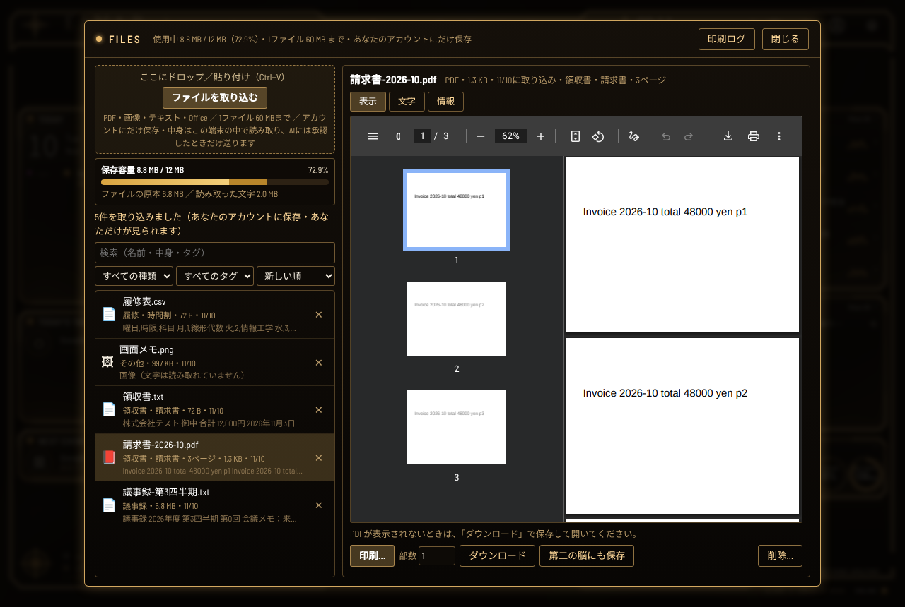

取り込み方:

- HUD の上にドラッグ＆ドロップする。
- 「ファイル」の画面の「ファイルを取り込む」ボタン。
- 貼り付ける（Ctrl+V）。

決まり:

- 1ファイル 60MB まで。全部で 500MB まで（既定。運営者が人ごとに変えられます）。ノート、会話、文字の抽出結果も、容量に数えます。
- PDF、画像、テキスト、Word、Excel、PowerPoint に対応しています。
- ファイルの中身は、あなたのブラウザで読みます。AIに中身を渡すときは、承認カードが出ます。
- 声で「〇〇をプリントして」と言うと、印刷できます。印刷の前に、承認カードが出ます。

くわしくは `docs/FILES_PRINT.md` と `docs/FILES_MEMORY.md` にあります。

## 8. 記憶

### 第二の脳（長期記憶）

HUD の上のバーのフォルダのアイコンで開きます。Markdownのノートを、見て、直して、検索できます。以前の版と、ゴミ箱（30日）もあります。

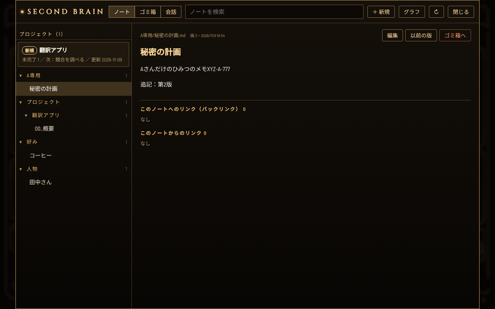

家計、シフト、履修、プロジェクトも、ここにノートとして入ります。学習した好みは「00_プロフィール.md」に入ります。いつでも見て、直して、消せます。

### 会話の記録（短期記憶）

会話は、サーバーに記録されます。履歴の画面で、1件ずつ消せます。

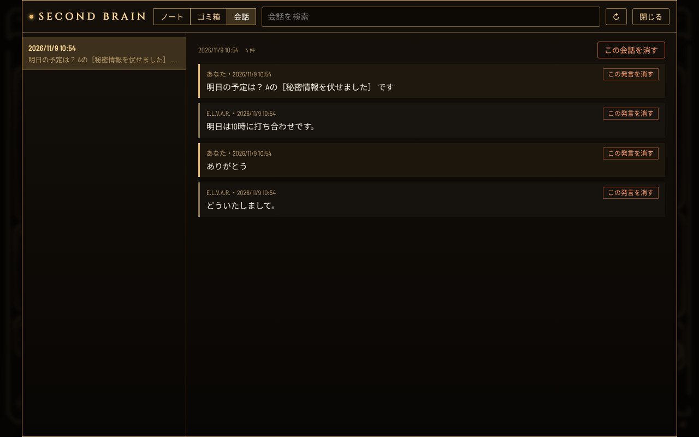

設定 → 「記憶」で、残す期間を決められます（7日から無期限まで。既定は180日）。「全部消す」もあります。

## 9. 利用量と上限

設定 → 「アカウント」→ 「利用状況を見る・上限を設定する」。

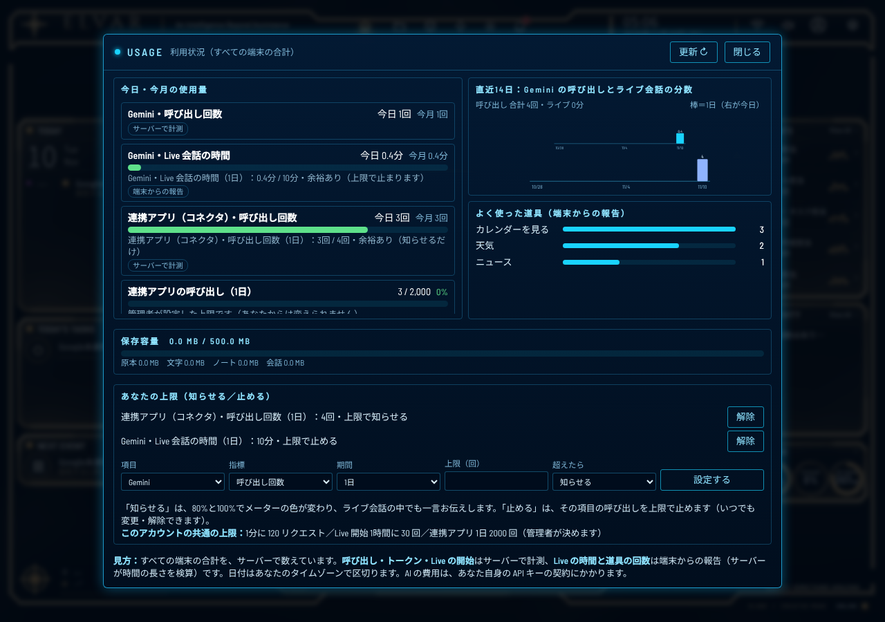

- 今日と今月の、AIの呼び出し回数、Live会話の時間、連携アプリの呼び出しが見えます。
- 保存容量の内訳（原本、文字、ノート、会話）も見えます。
- 「知らせる」か「止める」の上限を、自分で決められます。「知らせる」は、80%と100%でメーターの色が変わります。「止める」は、上限に達した項目の呼び出しを止めます。いつでも解除できます。
- 運営者が決める上限もあります。それは、あなたからは変えられません。
- AIの費用は、あなた自身のAPIキーの契約にかかります。ここの数字は目安です。

Live会話の時間と道具の回数は、あなたの端末からの報告をもとに数えています。

## 10. 私のデータ（見る・直す・持ち出す・消す）

設定 → 「私のデータ」。E.L.V.A.R. があなたについて持っているデータが、種類ごとに並びます。

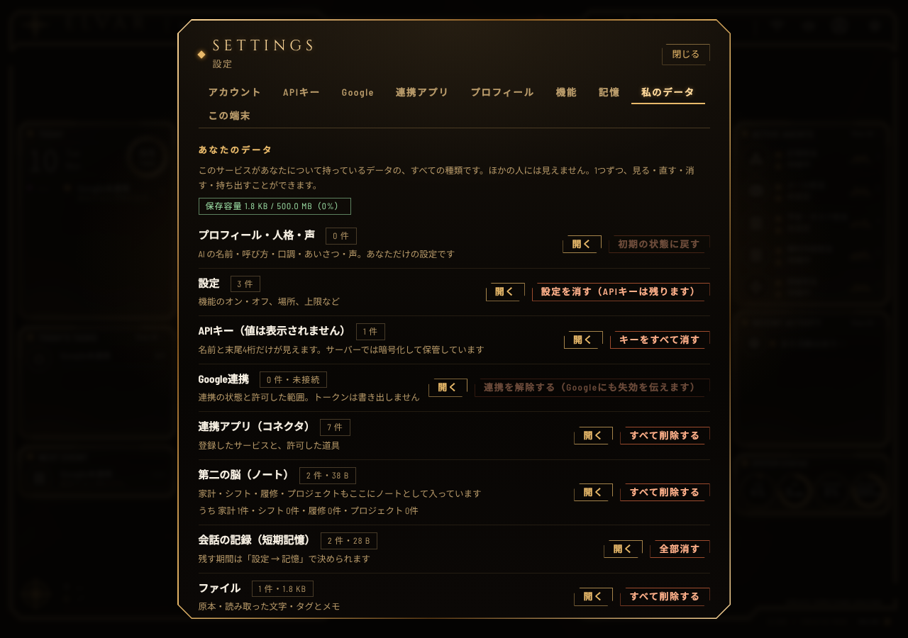

- **見る・直す**: 「開く」で、その種類の画面に移ります。
- **消す**: 種類ごとに、まとめて消せます。
- **書き出す**: 「全データの書き出しを始める」で、zip を作ります。ノート（Markdown）、会話、設定、ファイルの原本が入ります。APIキーなどの秘密の値は入りません（名前と末尾4桁だけ）。できたら、24時間のあいだダウンロードできます。書き出しは、1日1回までです。

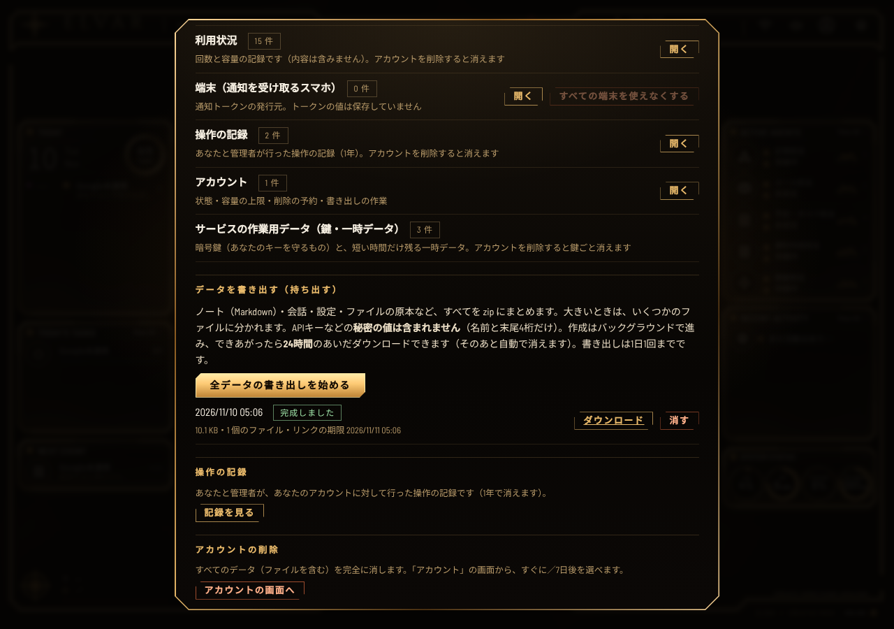

- **操作の記録**: あなたと管理者が、あなたのアカウントに対して行った操作を見られます。

### アカウントを完全に削除する

設定 → 「アカウント」→ 「アカウントを削除する」。

- 「7日後に削除する」: その間にサインインすると、取り消せます。
- 「今すぐ削除する」: 取り消せません。

削除すると、プロフィール、設定、暗号化したキー、ノート、会話、ファイル、連携のトークンがすべて消えます。GoogleやMCPのトークンは、先に相手側でも失効させます。
バックアップには、削除後も最大7日間残ることがあります。

## 11. 困ったとき

- **声が出ない・聞こえない**: ブラウザのマイクの許可を確かめます。「システムチェック」も試してください。
- **Geminiのキーが拒否された**: キーを作り直して、設定 → 「APIキー」で入れ直します。
- **429（上限）と出る**: Google側の枠か、あなたが決めた上限に達しています。「利用状況」を見てください。
- **容量がいっぱい**: 要らないファイルを消すか、運営者に容量の変更を頼みます。
- **Googleが「再接続が必要」と出る**: 設定 → Google で、もう一度「Googleと連携」を押します。
